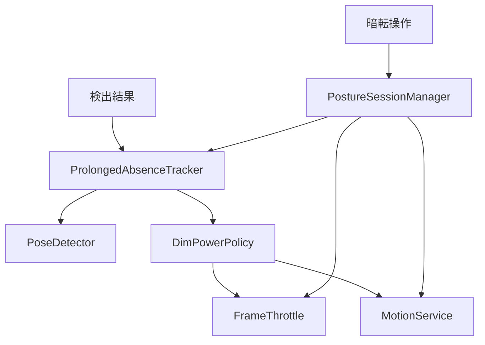
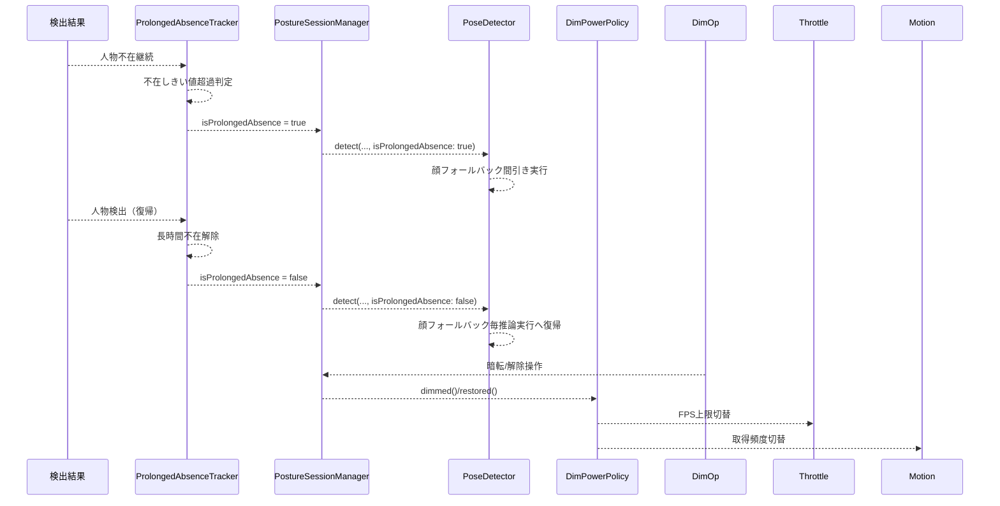
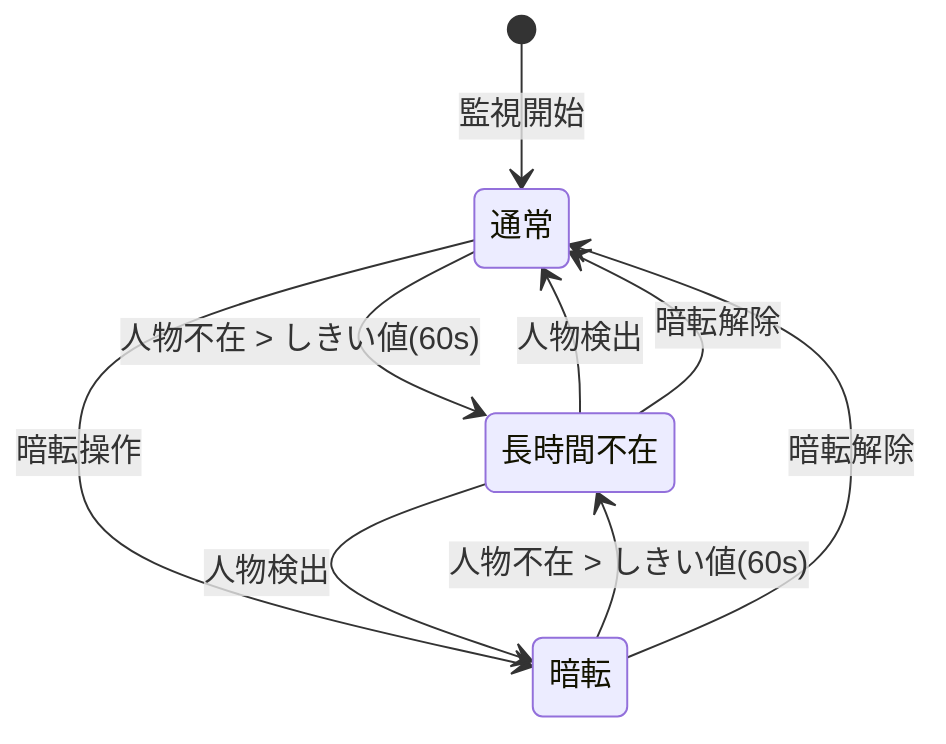

# Design: absent-vision-reduction

## Overview

本機能は、長時間人物不在が検出された場合に Vision 顔フォールバックの実行頻度を間引くことで視覚処理量を削減し、バッテリー消費を抑える。通常モード・画面暗転モードを問わず適用し、顔のみ検出を「人物あり」とする既存の検出意味（ADR-0021）を維持する。

**Purpose**: 長時間不在中の Vision 負荷増大（顔フォールバック毎推論実行）を間引き（既定 5 秒間隔）で解消し、通常/暗転両モードで実測可能な省電力効果を届ける。

**Users**: 長時間デスクワーク監視を行う利用者が、不在時に自動で省電力化される恩恵を受ける。開発者が条件別の実測で効果を検証する。

**Impact**: 既存の `DimPowerPolicy`（暗転段階管理）は不変。新規 `ProlongedAbsenceTracker`（モード非依存の長時間不在管理）を Session 層に追加し、`PoseDetector` に間引き制御を組み込む。判定・通知・カメラ稼働は不変。

---

## Goals

- 通常・暗転を問わず、人物不在継続がしきい値（既定 60 秒）を超えた場合に長時間不在状態へ遷移する
- 長時間不在中、姿勢観測ゼロ件時の顔フォールバック実行を間引き間隔（既定 5 秒）に制限する
- 暗転長時間不在では、窓あたり視覚処理量を暗転段階（顔フォールバック毎回実行）より低くする
- 顔フォールバック実行時は「顔のみ＝人物あり」の意味を維持し、復帰検出を間引き間隔内で保証する
- 長時間不在解除時に顔フォールバック頻度を通常（毎推論）へ戻す
- カメラ取得・推論 FPS 上限・重力取得頻度・判定ロジック・通知仕様を変更しない
- 通常/暗転の長時間不在それぞれで視覚処理量・電力指標を実測記録する

---

## Non-Goals

- 判定ロジック（3 秒連続確定・閾値・近側選択・代替基準鎖）の変更
- 通知仕様・UI デザインの変更
- バックグラウンド監視の追加
- カメラ取得の停止
- 推論実行頻度の上限（`FrameThrottle` 上限）自体の変更
- `DimPowerPolicy` の段階遷移則（暗転段階管理）の変更
- 新規外部依存の追加

---

## Boundary Commitments

### This Spec Owns

- **長時間不在の定義・検出・解除**（モード非依存、`ProlongedAbsenceTracker`）
- **顔フォールバック間引き制御**（間引き間隔既定 5 秒、`PoseDetector` 内実装）
- **間引き間隔・不在しきい値の既定値**および設定注入口
- **`PoseDetector.Metrics` への `faceThrottledCount` 追加**
- **条件別実測記録の項目・形式**（通常/暗転 長時間不在の視覚処理量・電力）

### Out of Boundary

- 暗転段階の定義・遷移・復帰（`DimPowerPolicy` が所有、`dim-mode-saving`）
- 推論 FPS 上限の決定・計測（`vision-fps-throttle` / `FrameThrottle`）
- 重力取得頻度の決定・計測（`motion-frequency` / `MotionService`）
- 3 秒連続確定判定・閾値・近側選択・代替基準鎖・通知仕様
- カメラ取得・表示・スリープ抑止の基本則
- `mainactor-throttle` のホップ集約則

### Allowed Dependencies

- `vision-face-conditional` (ADR-0021): 顔フォールバックと 3 値検出意味の前提
- `dim-mode-saving`: 不在しきい値（`DimPowerPolicy.defaultAbsentThreshold`）の共用のみ。段階遷移則は不変
- `vision-fps-throttle`: `FrameThrottle.setLimit(_:)` 受口の利用のみ（上限値変更なし）
- `motion-frequency`: `MotionService.setUpdateFrequency(_:)` 受口の利用のみ
- `mainactor-throttle`: 既存ホップ集約則の維持のみ
- Apple 純正フレームワークのみ（Vision, AVFoundation, CoreMotion, SwiftUI, XCTest）

### Revalidation Triggers

- `PoseDetector.detect()` インターフェース変更（引数追加）は、呼び出し側 `captureOutput` の再検証を要する
- `ProlongedAbsenceTracker` の公開インターフェース変更は、Session 結合テストの再検証を要する
- 間引き間隔（5 秒）変更は、実測比較（Req 2.2/3.2）の再確認を要する
- 不在しきい値（60 秒）変更は、`DimPowerPolicy` との整合再確認を要する
- `personMissingGracePeriod` (0.5s) との間引き間隔関係変更は、復帰検出・表示ちらつきの再検証を要する

---

## Architecture

### Existing Architecture Analysis

現行は `PostureSessionManager`（`@MainActor`）が状態の唯一の書き込み点。検出パイプライン：

```
captureOutput (detectionQueue)
  → FrameThrottle.shouldInfer() [間引き]
  → PoseDetector.detect() [姿勢→顔フォールバック]
  → LockedMainHopGate.submit() [ホップ集約]
  → Task { @MainActor } processDetection()
    → updateState() → DimPowerPolicy.tick() [段階遷移]
    → applyDimPowerStage() → FrameThrottle.setLimit() / MotionService.setUpdateFrequency()
```

`DimPowerPolicy.tick()` は暗転段階（`stage == .dimmed`）でのみ不在計測を行うため、通常モードの長時間不在を検出できない。

### Architecture Pattern & Boundary Map



**Architecture Integration**:

- Selected pattern: **純粋値型によるポリシー隔離** + 既存受口への制御指示（`dim-mode-saving` と同パターン）
- Domain/feature boundaries: 長時間不在管理は `ProlongedAbsenceTracker` 単独所有。暗転段階は `DimPowerPolicy` 継続所有
- Existing patterns preserved: Session 唯一書き込み点、間引き→条件化の順序、起停一本化、依存方向
- New components rationale: モード非依存の不在管理を値型に隔離し、カメラなしで単体検証可能にする
- Steering compliance: 新規依存なし、実測なき効果記載なし、3秒確定の意味不変、監視継続の期待変更なし

### Technology Stack

| Layer | Choice / Version | Role in Feature | Notes |
|-------|------------------|-----------------|-------|
| Session / Swift | 既存管理層 + 新規 `ProlongedAbsenceTracker` | 長時間不在判定・間引き制御・復帰 | 新規依存なし |
| Services / 既存検出基盤 | `PoseDetector` 修正 | 顔フォールバック間引き実装 | 方式自体の変更なし |

---

## File Structure Plan

### New Files

- `NekozeFix/Session/ProlongedAbsenceTracker.swift` — 新規。長時間不在の計測・遷移・間引き判定・閾値を持つ値型
- `NekozeFixTests/ProlongedAbsenceTrackerTests.swift` — 新規。遷移判定・間引き判定・閾値境界・復帰の単体検証

### Modified Files

- `NekozeFix/Services/PoseDetector.swift` — `detect()` に `isProlongedAbsence: Bool` と `inout ProlongedAbsenceTracker` 引数追加、間引きロジック実装、`Metrics` に `faceThrottledCount` 追加
- `NekozeFix/Session/PostureSessionManager.swift` — `prolongedAbsenceTracker` 保持、`updateState` で `tick` / `faceDetectedHoldActive(now:)` 呼び出し、`captureOutput` で bool + `inout Tracker` 渡し、復帰時 `reset()`
- `NekozeFixTests/PoseDetectorTests.swift` — 間引き動作・Metrics 拡張・復帰の単体検証追加
- `NekozeFixTests/PostureSessionManagerTests.swift` — 長時間不在遷移・解除・PoseDetector 連携の結合検証追加
- `docs/adr/XXXX-face-fallback-throttling.md` — 新規 ADR。間引き間隔・チラつき許容・同一間隔の決定根拠

### Shared File Arbitration

`PostureSessionManager.swift` は複数 spec が編集するため、適用順を固定：`vision-fps-throttle` → `mainactor-throttle` → `motion-frequency` → `dim-mode-saving` → **本 spec**。本 spec の編集は先行 spec 適用完了版を前提とし、既存の結合（間引きゲート・ホップゲート・起停一本化）を削除・移動しない。競合時は本 spec 側がリベースし、`ProlongedAbsenceTracker` 結合のみを付随させる。

### Unchanged Files（参照・回帰のみ、変更なし）

- `NekozeFix/Types/PostureTypes.swift` — 既存型契約不変
- `NekozeFix/Domain/PostureAnalyzer.swift` — 判定・代替解決不変
- `NekozeFix/Session/DimPowerPolicy.swift` — 暗転段階管理のみ継続所有（本 spec では触らない）
- `NekozeFix/Session/FrameThrottle.swift` — 上限変更受口の利用のみ
- `NekozeFix/Services/MotionService.swift` — 頻度設定受口の利用のみ
- `NekozeFix/UI/*` — 表示変更なし

---

## System Flows





- 長時間不在遷移は暗転操作・監視フェーズに依存せず、`ProlongedAbsenceTracker` 単独で判定
- 暗転段階遷移は従来どおり `DimPowerPolicy` が担当（二重管理だが責務は分離）
- 復帰（人物検出）で両方の「不在状態」が同時に解除される

---

## Requirements Traceability

| Requirement | Summary | Components | Interfaces | Flows |
|-------------|---------|------------|------------|-------|
| 1.1 | 監視中の不在継続時間計測 | ProlongedAbsenceTracker | `tick(isPersonDetected:now:)` | 不在計測フロー |
| 1.2 | しきい値超過で長時間不在扱い | ProlongedAbsenceTracker | `tick()` 戻り値 / `isProlongedAbsence` | 長時間不在遷移 |
| 1.3 | 人物検出で長時間不在解除 | ProlongedAbsenceTracker | `tick()` → `isProlongedAbsence=false` | 長時間不在解除 |
| 1.4 | 不在しきい値共用・暗転独立 | ProlongedAbsenceTracker | `init(absentThreshold:)` | 閾値共有 |
| 2.1 | 顔フォールバック頻度低下 | PoseDetector + Tracker | `detect(..., isProlongedAbsence:)` / `shouldExecuteFaceFallback()` | 間引き実行 |
| 2.2 | 暗転長時間不在で視覚処理量低下 | PoseDetector + Tracker | 実測ログ | 実測比較 |
| 2.3 | カメラ継続・FPS上限不変 | PostureSessionManager | 既存 `applyDimPowerStage` | 変更なし |
| 2.4 | 解除時頻度復帰 | PoseDetector + Tracker | `detect(..., false)` / `reset()` | 復帰フロー |
| 3.1 | 顔のみ=人物あり意味維持 | PoseDetector.synthesize() | 既存合成則 | 不変 |
| 3.2 | 復帰検出を間引き間隔内で | PoseDetector + Tracker | `shouldExecuteFaceFallback()` | 復帰検出保証 |
| 3.3 | 非長時間不在時は頻度不変 | PoseDetector | `detect(..., false)` | 不変 |
| 3.4 | 人物なし判定基準・表示則不変 | updateState | 既存デバウンス則 | 不変 |
| 4.1–4.5 | 判定・通知・監視継続不変 | Domain/Session/AlertPlayer | 既存契約 | 回帰テスト |
| 5.1–5.4 | 条件別実測記録 | Metrics log + Energy Report | 既存計測手段 | 実測テンプレート |

---

## Components and Interfaces

| Component | Domain/Layer | Intent | Req Coverage | Key Dependencies (P0/P1) | Contracts |
|-----------|--------------|--------|--------------|--------------------------|-----------|
| ProlongedAbsenceTracker | Session / 値型 | 長時間不在の計測・遷移・間引き判定・閾値 | 1.1–1.4, 2.1, 2.4 | `DimPowerPolicy.defaultAbsentThreshold` (P0) | State [x] |
| PoseDetector | Services | 姿勢検出・顔フォールバック間引き実行 | 2.1, 2.2, 2.4, 3.1–3.3 | ProlongedAbsenceTracker (P0), Vision (P0) | Service [x], State [x] |
| PostureSessionManager | Session | Tracker 所有・結合・PoseDetector への bool + inout Tracker 渡し | 1.1–1.4, 2.1–2.4, 3.1–3.4 | Tracker (P0), PoseDetector (P0), DimPowerPolicy (P0) | State [x] |
| Metrics 計測 | Session/Services | 視覚処理量・電力の実測記録 | 5.1–5.4 | 既存 5秒窓ログ (P0), Energy Report (P0) | State [x] |

---

### Session / ProlongedAbsenceTracker

#### 長時間不在トラッカー

| Field | Detail |
|-------|--------|
| Intent | モード非依存の長時間不在計測、遷移判定、顔フォールバック間引き判定、閾値・間隔の単一所有 |
| Requirements | 1.1, 1.2, 1.3, 1.4, 2.1, 2.4 |

**Responsibilities & Constraints**

- 人物不在継続時間を単調時計（`CACurrentMediaTime` 系）で計測する
- 不在しきい値（既定 60 秒、`DimPowerPolicy.defaultAbsentThreshold` 共用）超過で長時間不在状態へ遷移
- 人物検出で長時間不在を解除し、計測をリセットする
- 顔フォールバック間引き間隔（既定 5 秒）を内部に保持し、スレッドセーフに実行可否を判定・記録する
- 閾値・間隔はイニシャライザ注入、判定中に変わらない
- 暗転段階遷移（`DimPowerPolicy`）とは独立に動作する
- **`personMissing` 抑制用ホールド**: 顔検出実行後、次回顔実行可になるまで `isPersonDetected=true` を維持し、通常モードでの `personMissing` ちらつきを防止する（`lastFaceDetectedTime` で管理）

**Dependencies**

- Inbound: `PostureSessionManager` — 検出結果（デバウンス済み `isPersonDetected`）の受取り（P0）
- Outbound: `PostureSessionManager` — `isProlongedAbsence` / `shouldExecuteFaceFallback()` / `faceDetectedHoldActive` の提供（P0）

**Contracts**: Service [ ] / API [ ] / Event [ ] / Batch [ ] / State [x]

##### Interface

```swift
/// スレッドセーフな長時間不在トラッカー（Session層・値型）。
/// 内部状態はロックで保護し、単一の `tick(now:)` と `shouldExecuteFaceFallback(now:)` で
/// 全状態更新をアトミックに行う。`MotionService.SharedState` と同パターンで
/// NSLock による内部同期を行う。`@unchecked Sendable` 準拠。
@unchecked Sendable
struct ProlongedAbsenceTracker {
    /// 不在しきい値（秒）。既定は DimPowerPolicy.defaultAbsentThreshold (60s)。
    let absentThreshold: TimeInterval
    /// 顔フォールバック間引き間隔（秒）。既定 5 秒。
    let faceFallbackThrottleInterval: TimeInterval

    private let lock = NSLock()
    private var _isProlongedAbsence: Bool = false
    private var absenceStart: TimeInterval?
    private var lastFaceExecutionTime: TimeInterval = -.infinity
    private var lastFaceDetectedTime: TimeInterval?

    /// - Parameters:
    ///   - absentThreshold: 人物なし継続秒数（正の有限値）。不正値は既定値に倒す。
    ///   - faceFallbackThrottleInterval: 顔フォールバック最小実行間隔（正の有限値）。不正値は既定値に倒す。
    init(
        absentThreshold: TimeInterval = DimPowerPolicy.defaultAbsentThreshold,
        faceFallbackThrottleInterval: TimeInterval = 5.0
    ) {
        self.absentThreshold = (absentThreshold.isFinite && absentThreshold > 0) ? absentThreshold : DimPowerPolicy.defaultAbsentThreshold
        self.faceFallbackThrottleInterval = (faceFallbackThrottleInterval.isFinite && faceFallbackThrottleInterval > 0) ? faceFallbackThrottleInterval : 5.0
    }

    /// 現在長時間不在中か（ロック保護付き読み取り）。
    var isProlongedAbsence: Bool {
        lock.withLock { _isProlongedAbsence }
    }

    /// 検出結果による長時間不在判定・ホールド状態更新。
    /// - Parameters:
    ///   - isPersonDetected: デバウンス済み人物検出状態（`updateState` 確定後の値）
    ///   - now: 単調時刻系（`CACurrentMediaTime` 系）。無効時刻は遷移を見送る。
    /// - Returns: 更新後の `isProlongedAbsence`
    mutating func tick(isPersonDetected: Bool, now: TimeInterval) -> Bool {
        return lock.withLock {
            guard now.isFinite, now >= 0 else { return _isProlongedAbsence }
            if isPersonDetected {
                absenceStart = nil
                lastFaceDetectedTime = now
                if _isProlongedAbsence {
                    _isProlongedAbsence = false
                }
                return _isProlongedAbsence
            }
            guard _isProlongedAbsence == false else { return true } // 既に長時間不在なら継続
            guard let start = absenceStart else {
                absenceStart = now
                return false
            }
            guard now >= start else {
                absenceStart = now
                return false
            }
            if now - start > absentThreshold {
                _isProlongedAbsence = true
            }
            return _isProlongedAbsence
        }
    }

    /// 顔フォールバックをこの推論で実行すべきか判定し、実行可なら時刻を記録する。
    /// 長時間不在中かつ前回実行から間引き間隔以上経過なら true を返し、内部で実行時刻を更新する。
    /// - Parameter now: 単調時刻系（`CACurrentMediaTime` 系）。
    /// - Returns: 実行すべきなら true。呼び出し側は true 時にのみ顔検出を実行する。
    mutating func shouldExecuteAndRecordFaceFallback(now: TimeInterval) -> Bool {
        return lock.withLock {
            guard _isProlongedAbsence else { return true } // 長時間不在でなければ毎回実行
            guard now.isFinite, now >= 0 else { return true }
            // lastFaceExecutionTime は非 Optional（初期値 -∞）
            if now - lastFaceExecutionTime < faceFallbackThrottleInterval {
                return false
            }
            lastFaceExecutionTime = now
            // 注: ここでは顔検出結果を得る前のため lastFaceDetectedTime は更新しない
            // 顔実行後に recordFaceDetected(now:) で更新する
            return true
        }
    }

    /// 顔検出が実行された（.personOnly または .pose を返した）ことを通知し、ホールド時刻を更新する。
    /// `shouldExecuteAndRecordFaceFallback` が true を返した後、実際に顔リクエストを発行して結果を得た場合に呼ぶ。
    mutating func recordFaceDetected(now: TimeInterval) {
        lock.withLock {
            guard now.isFinite, now >= 0 else { return }
            lastFaceDetectedTime = now
        }
    }

    /// 顔検出ホールドが有効か（最後に顔検出してから間引き間隔未満か）。
    /// `updateState` で表示用の `isPersonDetected` を `true` に維持するか判定するために使用。
    /// 実検出状態とは分離し、表示ちらつき抑制のみに用いる。
    func faceDetectedHoldActive(now: TimeInterval) -> Bool {
        lock.withLock {
            guard _isProlongedAbsence else { return false }
            guard let last = lastFaceDetectedTime else { return false }
            // 長時間不在中かつホールド期間内なら true
            return now - last < faceFallbackThrottleInterval
        }
    }

    /// 長時間不在解除・監視開始・復帰時に状態をリセットする。
    mutating func reset() {
        lock.withLock {
            _isProlongedAbsence = false
            absenceStart = nil
            lastFaceExecutionTime = -.infinity
            lastFaceDetectedTime = nil
        }
    }

    /// 現在の状態をスナップショットとして取得（テスト・ログ用）。
    struct Snapshot: Equatable {
        let isProlongedAbsence: Bool
        let absenceStart: TimeInterval?
        let lastFaceExecutionTime: TimeInterval
        let lastFaceDetectedTime: TimeInterval?
    }
    func snapshot() -> Snapshot {
        lock.withLock {
            Snapshot(
                isProlongedAbsence: _isProlongedAbsence,
                absenceStart: absenceStart,
                lastFaceExecutionTime: lastFaceExecutionTime,
                lastFaceDetectedTime: lastFaceDetectedTime
            )
        }
    }
}
```

- Preconditions: `tick` の入力はデバウンス済み `isPersonDetected` のみ。生検出不使用。`now` は単調時計。無効値は遷移を見送る
- Postconditions: `tick` 呼び出しごとに `isProlongedAbsence` が更新され、遷移時は新値を返す
- Invariants: しきい値・間隔は判定中不変。`absenceStart` は `isProlongedAbsence == true` の間のみ非 nil。`lastFaceDetectedTime` は顔実行時のみ更新。

##### State Management

- State model: `isProlongedAbsence`、`absenceStart`、`lastFaceExecutionTime`、`lastFaceDetectedTime`、`absentThreshold`、`faceFallbackThrottleInterval`（すべて `lock` で保護）
- Persistence & consistency: プロセス内メモリのみ。判定経路は既存直列実行に従い新規キューを作らない
- Concurrency strategy: **`NSLock` 内包によるスレッドセーフ設計**。`tick`（MainActor）、`shouldExecuteAndRecordFaceFallback`/`recordFaceDetected`/`faceDetectedHoldActive`（detectionQueue）が同一ロックで直列化。`MotionService.SharedState` と同パターン。

**Implementation Notes**

- Integration: `PostureSessionManager` がインスタンスを保持し、`updateState` で `tick`、`captureOutput` で `shouldExecuteAndRecordFaceFallback` / `recordFaceDetected`、`updateState` で `faceDetectedHoldActive` 参照
- Validation: 遷移判定・間引き判定・ホールド動作・閾値境界・復帰リセットを単体検証する
- Risks: しきい値・間隔の既定値不適合 → 実測記録での見直しを再検証トリガーとして扱う

---

### Services / PoseDetector

#### 顔フォールバック間引き実装

| Field | Detail |
|-------|--------|
| Intent | 姿勢観測ゼロ件時の顔検出を、長時間不在中のみ間引き間隔で実行する |
| Requirements | 2.1, 2.2, 2.4, 3.1, 3.2, 3.3 |

**Responsibilities & Constraints**

- `detect(sampleBuffer:orientation:isProlongedAbsence:prolongedAbsenceTracker:)` にて、長時間不在中かつ姿勢観測ゼロ件の場合、Tracker 内部で間引き判定を行い、実行可なら顔検出を実行、不可なら即 `.absent` を返す（`faceThrottledCount` インクリメント）
- 顔検出実行時は従来どおり `synthesize(pose: nil, faceBounds:)` を適用し、`.personOnly` / `.absent` を返す（ADR-0021 意味維持）
- 長時間不在でない場合（`isProlongedAbsence == false`）は従来どおり毎回顔フォールバックを実行
- `Metrics` に `faceThrottledCount` を追加し、間引きでスキップした回数を計数する
- 顔検出実行後（`.personOnly` または `.pose` を返す直前）、Tracker に `recordFaceDetected(now:)` を呼びホールド時刻更新

**Dependencies**

- Inbound: `PostureSessionManager.captureOutput` — 検出依頼＋`isProlongedAbsence: Bool` と `ProlongedAbsenceTracker` インスタンス渡し（P0）
- Outbound: Vision Framework — `VNDetectHumanBodyPoseRequest` / `VNDetectFaceRectanglesRequest`（P0）

**Contracts**: Service [x] / API [ ] / Event [ ] / Batch [ ] / State [x]

##### Interface Changes

```swift
final class PoseDetector: @unchecked Sendable {
    struct Metrics: Equatable {
        var faceSkippedCount = 0       // 姿勢ありでスキップ（従来）
        var faceExecutedCount = 0      // 顔実行した回数
        var faceThrottledCount = 0     // 長時間不在間引きでスキップした回数【新規】
        var poseTotalTime: Double = 0
        var faceTotalTime: Double = 0
    }

    func detect(
        sampleBuffer: CMSampleBuffer,
        orientation: CGImagePropertyOrientation,
        isProlongedAbsence: Bool,
        prolongedAbsenceTracker: inout ProlongedAbsenceTracker
    ) -> Detection { ... }
}
```

- Preconditions: `isProlongedAbsence == true` かつ姿勢観測ゼロ件の場合のみ間引き判定を行う。Tracker 内部で `shouldExecuteAndRecordFaceFallback(now:)` を実行し、実行可否と実行時刻記録をアトミックに行う
- Postconditions: 間引きスキップ時は `.absent` を返す（`faceThrottledCount++`）。顔実行時は従来合成則に従う。顔実行後（`.personOnly` または `.pose`）は内部で `prolongedAbsenceTracker.recordFaceDetected(now:)` を呼ぶ。`Metrics` が更新される
- Invariants: `synthesize` の意味（`pose ?? (faceBounds != nil ? .personOnly : .absent)`）は不変

##### State Management

- State model: `Metrics`（`NSLock` で保護）、間引き判定・ホールド状態は `ProlongedAbsenceTracker` が保持
- Persistence & consistency: プロセス内メモリのみ。永続化・外部送出なし
- Concurrency strategy: `detectionQueue` 上で同期実行。`Metrics` はロックで保護。Tracker は内部 `NSLock` でスレッドセーフ

**Implementation Notes**

- Integration: `captureOutput` 内で `detection = poseDetector.detect(sampleBuffer: sampleBuffer, orientation: .up, isProlongedAbsence: isProlongedAbsence, prolongedAbsenceTracker: &tracker)` を呼ぶ。Tracker との連携は `detect()` 内部で完結
- Validation: 間引き動作・Metrics 計数（`faceThrottledCount`）・復帰時毎回実行・非長時間不在時毎回実行・ホールドによる `personMissing` 抑制を単体・結合で検証
- Risks: なし（Tracker 内部でアトミックに判定・記録するため脱調なし。ホールド機構で `personMissing` ちらつき防止済み）

---

### Session / PostureSessionManager

#### 長時間不在トラッカーの所有と結合

| Field | Detail |
|-------|--------|
| Intent | `ProlongedAbsenceTracker` を保持し、`updateState` で `tick` / `faceDetectedHoldActive(now:)` 参照、`captureOutput` で bool + Tracker 渡し、`reset()` で復帰制御 |
| Requirements | 1.1–1.4, 2.1–2.4, 3.1–3.4 |

**Responsibilities & Constraints**

- `prolongedAbsenceTracker` をインスタンス変数として保持（イニシャライザで閾値・間隔注入）
- `updateState(presence:...)` 内で `tracker.tick(isPersonDetected: snapshot.isPersonDetected, now:)` を呼び、`isProlongedAbsence` 変化時にログ等出力（任意）
- **ホールド抑制（表示のみ）**: 長時間不在中かつホールド有効時、表示用 `isPersonDetected` を `true` に維持（`personMissing` 表示を防ぐ）。**実検出状態（`DimPowerPolicy` への入力等）とは分離する**
- `captureOutput` 内で `isProlongedAbsence` と `inout prolongedAbsenceTracker` を `poseDetector.detect(..., isProlongedAbsence:, prolongedAbsenceTracker:)` に渡す。間引き判定・実行・ホールド更新は `detect()` 内部で完結
- 長時間不在解除（`tracker.tick` が `false` を返したとき）で `tracker.reset()` を呼び、通常頻度へ即座に復帰
- 既存の `DimPowerPolicy` 結合（暗転段階遷移・FPS/頻度切替）は変更しない。二重管理だが責務分離を維持

**Dependencies**

- Inbound: 検出結果・暗転操作・ライフサイクルイベント（P0）
- Outbound: `ProlongedAbsenceTracker`（P0）、`PoseDetector`（P0）、`DimPowerPolicy`（P0）、`FrameThrottle`/`MotionService`（P0）

**Contracts**: State [x]

##### Integration Points

- `updateState` 追加ロジック（MainActor）:
  ```swift
  let wasProlonged = prolongedAbsenceTracker.isProlongedAbsence
  let now = CACurrentMediaTime()
  let isNowProlonged = prolongedAbsenceTracker.tick(isPersonDetected: snapshot.isPersonDetected, now: now)
  if wasProlonged != isNowProlonged {
      // 遷移ログ等（任意）
  }
  if !isNowProlonged && wasProlonged {
      prolongedAbsenceTracker.reset() // 復帰時リセット
  }
  // 長時間不在中の顔検出ホールド: 間引き間隔内に顔検出があれば 表示用 isPersonDetected を true 維持
  // 実検出状態（DimPowerPolicy 入力等）は元の snapshot.isPersonDetected のまま保持
  let displayIsPersonDetected = prolongedAbsenceTracker.faceDetectedHoldActive(now: now) || snapshot.isPersonDetected
  ```

- `captureOutput` 追加ロジック（detectionQueue）:
  ```swift
  let isProlonged = prolongedAbsenceTracker.isProlongedAbsence
  let detection = poseDetector.detect(
      sampleBuffer: sampleBuffer,
      orientation: .up,
      isProlongedAbsence: isProlonged,
      prolongedAbsenceTracker: &prolongedAbsenceTracker
  )
  // 間引き判定・顔実行・ホールド更新は detect() 内部で完結
  ```

**Implementation Notes**

- Integration: 既存 `DimPowerPolicy` 結合行（`dimPowerPolicy.tick` 呼び出し）の直前/直後に `prolongedAbsenceTracker.tick` を追加。順序依存なし。`faceDetectedHoldActive(now:)` 参照は表示用 `isPersonDetected` 計算時に使用
- Validation: 通常/暗転それぞれで長時間不在遷移・解除・PoseDetector 間引き・ホールド抑制・復帰を結合検証
- Risks: 二重の不在計測（DimPowerPolicy + ProlongedAbsenceTracker）が乖離しないよう、同一 `isPersonDetected`・同一 `now` で呼ぶこと

---

### Session / Metrics 計測（既存拡張）

| Field | Detail |
|-------|--------|
| Intent | 通常/暗転の長時間不在それぞれで視覚処理量・電力を実測し、暗転段階・在席時と比較記録する |
| Requirements | 5.1–5.4 |

**Responsibilities & Constraints**

- 既存 5 秒窓ログ `[NekozeFix Metrics]` を拡張し、`PoseDetector.Metrics.faceThrottledCount` を出力に含める
- 実測条件: 通常モード長時間不在 / 暗転モード長時間不在 / 暗転段階（在席） / 通常モード在席 / 長時間監視
- 電力は Xcode Energy Report（Average Energy Impact ゲージ色評価 + Average Component Utilization 領域別%）で取得（ADR-0025）
- 推定値・換算値を記載しない。測定不能項目は「未計測」と明記

**Contracts**: State [x]

---

## Data Models

本機能で新規に定義するデータモデル：

### ProlongedAbsenceTracker (Session 値型・スレッドセーフ)

```swift
@unchecked Sendable
struct ProlongedAbsenceTracker {
    let absentThreshold: TimeInterval           // 既定 60s（DimPowerPolicy 共用）
    let faceFallbackThrottleInterval: TimeInterval // 既定 5s

    private let lock = NSLock()
    private var _isProlongedAbsence: Bool = false
    private var absenceStart: TimeInterval?
    private var lastFaceExecutionTime: TimeInterval = -.infinity
    private var lastFaceDetectedTime: TimeInterval?

    init(
        absentThreshold: TimeInterval = DimPowerPolicy.defaultAbsentThreshold,
        faceFallbackThrottleInterval: TimeInterval = 5.0
    ) { ... }

    var isProlongedAbsence: Bool { ... }
    mutating func tick(isPersonDetected: Bool, now: TimeInterval) -> Bool { ... }
    mutating func shouldExecuteAndRecordFaceFallback(now: TimeInterval) -> Bool { ... }
    mutating func recordFaceDetected(now: TimeInterval) { ... }
    func faceDetectedHoldActive(now: TimeInterval) -> Bool { ... }
    mutating func reset() { ... }
    struct Snapshot: Equatable { ... }
    func snapshot() -> Snapshot { ... }
}
```

- 既存 `DimPowerPolicy` と併存。責務は完全分離（段階遷移 vs モード非依存不在管理）
- `NSLock` 内包でスレッドセーフ。`MotionService.SharedState` 同パターン
- 値型のためコピー時は状態共有されず、`inout` 渡しで同一インスタンスを共有

### PoseDetector.Metrics 拡張

```swift
struct Metrics: Equatable {
    var faceSkippedCount = 0       // 姿勢ありでスキップ
    var faceExecutedCount = 0      // 顔実行
    var faceThrottledCount = 0     // 間引きスキップ【新規】
    var poseTotalTime: Double = 0
    var faceTotalTime: Double = 0
}
```

- 既存計測ログ出力に `faceThrottledCount` を追加

---

## Error Handling

### Error Strategy

監視継続を優先し、長時間不在管理の異常時は非長時間不在側（`isProlongedAbsence = false`）に倒して検出機会を保つ。

### Error Categories and Responses

- `ProlongedAbsenceTracker` 初期化時の不正閾値・間隔: 既定値（60s / 5s）に倒す
- `PoseDetector.detect()` で `isProlongedAbsence` 判定不能: 長時間不在でない扱い（毎回顔実行）に倒す
- `shouldExecuteFaceFallback` 時刻不正: 実行可（`true`）に倒す
- 復帰時 `reset()` 失敗: 次回 `tick` で自然にリセットされるため無視
- 既存エラー戦略（カメラ停止・Vision 失敗等）は不変

---

## Testing Strategy

- **Unit Tests**:
  - `ProlongedAbsenceTrackerTests`: 初期状態、不正閾値フォールバック、遷移（通常→長時間不在→解除）、人物再検出前/後、閾値境界（59.9s/60.0s/60.1s）、間引き判定（実行可/不可/実行後リセット）、リセット動作、無効時刻無視
  - `PoseDetectorTests`: 間引き有効時の顔スキップ（`.absent` 返却）、間引き無効時の毎回実行、Metrics 計数（`faceThrottledCount` 含む）、復帰時毎回実行、合成則不変（`synthesize` 既存テストで回帰確認）
  - `DimPowerPolicyTests`: 既存テスト維持（本 spec 変更なし）

- **Integration Tests**:
  - `PostureSessionManagerTests`: 通常モード長時間不在遷移・解除、暗転モード長時間不在遷移・解除、暗転解除での通常復帰、PoseDetector 間引き連携（`isProlongedAbsence` 渡し・実行記録）、DimPowerPolicy との併存確認
  - `FrameThrottleTests` / `MotionServiceTests`: 既存回帰（全段階条件で再実行）

- **E2E/UI Tests（実機）**:
  - 通常モード長時間不在→復帰の操作回帰
  - 暗転モード長時間不在→復帰の操作回帰
  - 復帰検出遅延の計測（間引き間隔内であること確認）
  - 長時間監視での安定性確認

- **Performance/Load（実機）**:
  - 条件別電力・復帰時間・検出精度の記録（通常長時間不在 / 暗転長時間不在 / 暗転在席 / 通常在席 / 長時間監視）
  - 通常時との比較、NFR 9.2（暗転時は通常より低消費）との整合確認
  - 推定記載なし、未計測明記（ADR-0025 準拠）

---

## Supporting References

- ADR-0021: 顔フォールバック（二段階 perform）・3 値検出意味
- ADR-0022: ホップゲート結線・間引き→条件化順序
- ADR-0024: 暗転長時間不在の実効実行数による更なる低下（上限 10fps 据置き）
- ADR-0025: Energy Impact を電力測定手段として採用
- `absent-vision-cost-4-2.md`: 不在時 Vision 負荷増大の実測根拠
- `CONTEXT.md`: 用語定義（長時間不在・不在しきい値・顔フォールバック間引き 更新済み）

---

## Open Questions / Risks（設計段階で残る判断）

1. **間引き間隔 5 秒の妥当性**: 実測で Vision 時間削減効果と復帰遅延のバランスを確認し、必要なら設計変更（ADR 更新）
2. **二重不在管理の整合性**: `DimPowerPolicy`（暗転段階用）と `ProlongedAbsenceTracker`（モード非依存）が同一 `isPersonDetected`・同一 `now` で呼ばれる限り乖離しないが、結合テストで明示確認
3. **ADR 番号**: 連番で `docs/adr/XXXX-face-fallback-throttling.md` を作成（設計確定時に割当）