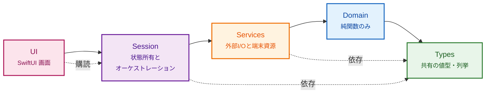
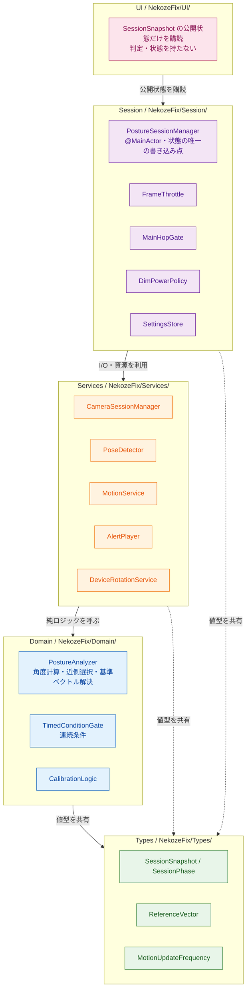
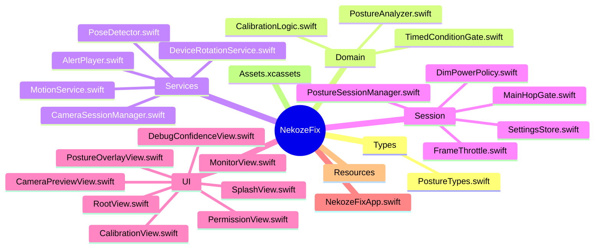
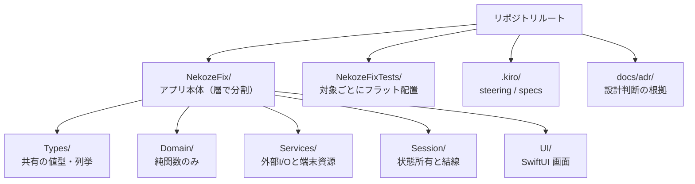
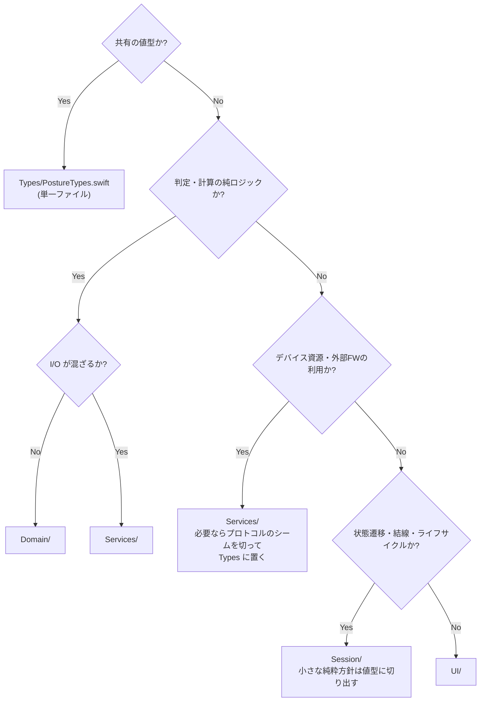

# Architecture Diagram

_Last updated: 2026-10-17_

`structure.md` のアーキテクチャとディレクトリ層を図解した補助ドキュメント。依存方向・層の責務・ディレクトリ構成の唯一の正は `structure.md` であり、本書はその可視化のみを担う。

## 1. 単方向レイヤード（依存方向）

左の層は右の層を知らない。依存は常に `Types` 方向へ流れる。

**Why**: 層をまたぐ循環依存を防ぎ、Domain をカメラなしで単体検証可能にし、状態の書き込み点を1つに集約して判定の整合性を保つ。

## 2. 各層の責務と主要型

## 3. ディレクトリ構成（層で分割）

機能ではなく**層**で分割する。テストはフラット配置。

## 4. 配置の判断フロー

新しい型・関数をどの層に置くかの目安。

