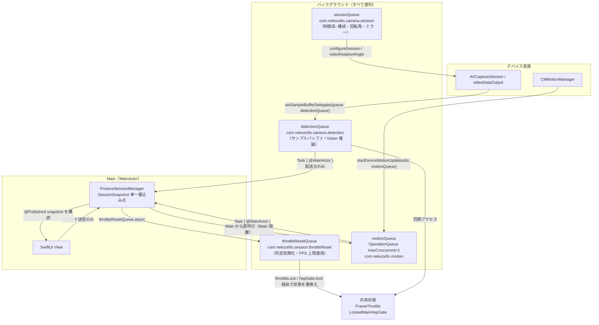
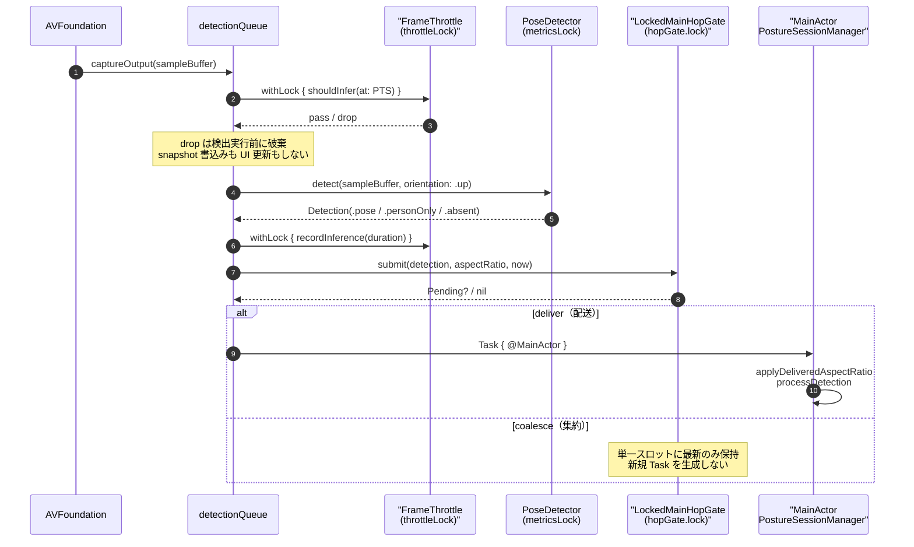
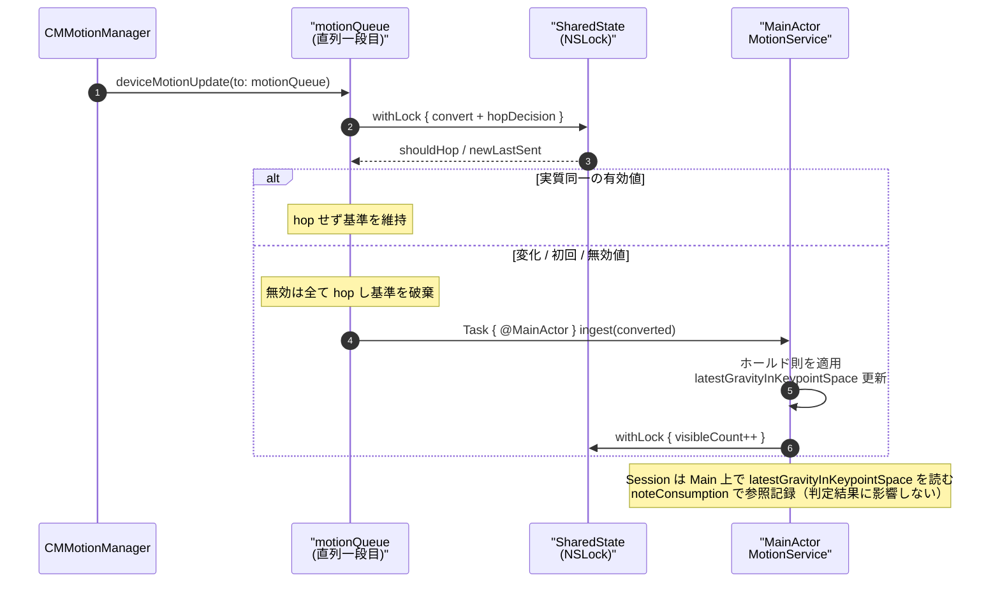
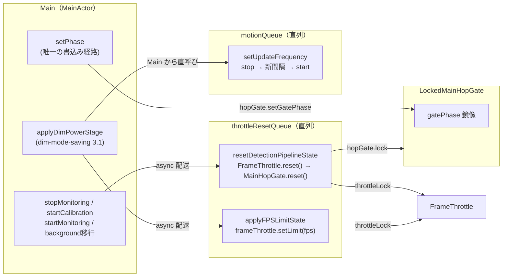

# 並行モデル図解（ロック・キュー）

_Last updated: 2026-10-17_

`tech.md`「Concurrency Model」の規則を、実際のキュー・ロック・共有状態の関係として図解した補助ドキュメント。並行性の規則・既定値の唯一の正は `tech.md`（および各 spec の design.md / ADR）であり、本書はその可視化のみを担う（`architecture-diagram.md` が `structure.md` を補うのと同様）。

- 設計参照: `.kiro/specs/vision-fps-throttle/design.md`、`.kiro/specs/mainactor-throttle/design.md`、`.kiro/specs/motion-frequency/design.md`
- 判断参照: `docs/adr/0022-hop-gate-wiring.md`、`docs/adr/0023-motion-hop-two-stage-and-restart.md`、`docs/adr/0024-dim-absent-effective-rate.md`

## 1. キューとスレッドのトポロジ

`PostureSessionManager`（MainActor）が状態の唯一の書き込み点であり、
推論・重力取得はバックグラウンドの直列キュー上で走り、UI 更新のみ Main へ hop する。

補足:

- `alwaysDiscardsLateVideoFrames = true` により、`detectionQueue` が処理中の後続フレームは AVFoundation 側で間引かれ滞留しない。待機キュー・バッファは新設しない。
- 事象駆動の受け渡し（回転角・カメラ確定・設定変更）は Main へ hop し、判定用の間引きゲート（下記）を通さない。

## 2. フレーム経路（discovery → Main 配送）

`captureOutput`（detectionQueue・同期）で「間引き → 推論 → ゲート」の順に処理し、
配送分のみ `Task { @MainActor }` で Main に渡す。

ゲートの配送条件（`MainHopGate.shouldDeliver`）:

- 校正中（`phase == .calibrating`）は全量配送
- 検出種別の遷移、非 pose 結果は間隔無視で配送
- 画面比率の変化（許容誤差付き）は間隔無視で配送
- 定常 pose 連続のみ表示更新間隔（既定 0.1 秒）で間引き
- 集約分は単一スロットに最新のみ保持し、排出時は今回の検出結果で判定と表示を一括反映

## 3. 重力経路（二段 hop）

`motionQueue`（直列）の一段目で変換・実質同一判定を行い、
hop したサンプルのみ Main 二段目（ホールド則）へ渡す。

## 4. ロックと保護対象

「検出キュー / `throttleResetQueue` / Main」をまたぐ可変状態は、所有者ごとの `NSLock` で直列化する。
ロック階層は新設せず、各共有状態が単一のロックを持つ。

| ロック | 所有者 | 保護対象 | アクセス経路 |
|---|---|---|---|
| `throttleLock` | `PostureSessionManager` | `frameThrottle`（`FrameThrottle` 値型） | detectionQueue（間引き・記録）／`throttleResetQueue`（reset・上限適用）／Main（計測読出し） |
| `LockedMainHopGate.lock` | `LockedMainHopGate` | `gate`（`MainHopGate` 値型）・フェーズ鏡像・単一スロット | detectionQueue（submit）／`throttleResetQueue`（reset）／Main（setGatePhase・計測読出し） |
| `SharedState.lock` | `MotionService` | `lastSent`・計測カウンタ | motionQueue（一段目）／Main（ingest・計測） |
| `metricsLock` | `PoseDetector` | 推論回数・累積推論時間 | detectionQueue（detect のみ） |
| （なし）`nonisolated(unsafe)` | `PostureSessionManager` | `frameThrottle` / `hopGate` の参照 | 参照は不変。値の保全は上記ロックが担う |

補足:

- `frameThrottle` と `hopGate` は `nonisolated(unsafe)` で公開する。参照の不変性と各ロックで安全性を担保し、新たなロック階層は増やさない。
- `latestGravityInKeypointSpace` は `@MainActor` 隔離のまま。検出キューからは読まず、判定読取りは Main（`processDetection`）で行う。
- フェーズは `snapshot`（`@MainActor`）を検出キューのゲートへ持ち込まず、`setPhase` から `LockedMainHopGate` 内の軽量鏡像へ反映する（ADR-0022）。初期値は fail-open の `.calibrating`。

## 5. 制御経路（停止・再開・省電力段階）

判定状態の初期化と FPS 上限の切替えは、Main から `throttleResetQueue` へ async 配送し、
検出キューとロックで直列化する。`MainActor` を block する同期配送は行わない。

補足:

- 推論上限の段階マッピング（normal 15 / dimmed・dimmedAbsent 10 FPS）と取得頻度（30 / 15 / 10 Hz）は Session 所有（ADR-0024）。上限切替えは検出キュー相当へ async 配送し、判定中の変更を起こさない。
- 取得頻度の変更は停止中は次回開始時から反映する既存則に従う（ADR-0023）。
- 経過時間・ゲート・しきい値判定には `CACurrentMediaTime` 系（`TimeInterval`）を使い、`Date`（暦時刻）を使わない。`MotionService` のホールド則と区間計測の `Date` は設計上の例外。
