# スレッド同期機構（NSLock・キュー・共有状態）図解

_Last updated: 2026-10-19_

`tech.md`「Concurrency Model」および `concurrency-model.md` の規則を、**NSLock を中心とした同期境界**として詳細に図解した補助ドキュメント。実装パターンの唯一の正は各 Swift ファイルであり、本書はその可視化のみを担う。

---

## 1. NSLock 同期境界の全体像

このプロジェクトでは、**5つの NSLock** が各共有状態を所有し、検出キュー・MainActor・制御キュー間のデータ競合を防ぐ。

```mermaid
flowchart TB
    subgraph DQ["detectionQueue<br/>(com.nekozefix.camera.detection)"]
        direction TB
        CAP["captureOutput(sampleBuffer)"]
        INF["Vision 推論"]
        THR1["FrameThrottle.withLock"]
        THR2["FrameThrottle.recordInference"]
        SUB["LockedMainHopGate.submit"]
        FACE["ProlongedAbsenceTracker.tick"]
        FB["ProlongedAbsenceTracker.shouldExecuteAndRecordFaceFallback"]
    end

    subgraph TRQ["throttleResetQueue<br/>(com.nekozefix.session.throttleReset)"]
        RESET["FrameThrottle.reset<br/>LockedMainHopGate.reset"]
        FPS["FrameThrottle.setLimit"]
    end

    subgraph MQ["motionQueue<br/>(OperationQueue maxConcurrent=1)"]
        MOT["deviceMotionUpdate"]
        SHARED_W["SharedState.lock.withLock<br/>(convert + hopDecision)"]
    end

    subgraph MAIN["MainActor (PostureSessionManager / MotionService)"]
        PHASE["setGatePhase"]
        INGEST["ingest(converted)"]
        READ1["frameThrottle.snapshot<br/>hopGate.snapshot"]
        READ2["prolongedAbsenceTracker.isProlongedAbsence<br/>faceDetectedHoldActive"]
        MREAD["SharedState.lock.withLock<br/>(visibleCount++ / readCount++)"]
    end

    subgraph LOCKS["NSLock 保護境界（各々独立・階層なし）"]
        TL["throttleLock<br/>(PostureSessionManager)"]
        HL["LockedMainHopGate.lock<br/>(LockedMainHopGate)"]
        SL["SharedState.lock<br/>(MotionService)"]
        ML["metricsLock<br/>(PoseDetector)"]
        PL["ProlongedAbsenceTracker.lock<br/>(ProlongedAbsenceTracker)"]
    end

    CAP --> THR1
    THR1 --> TL
    INF --> THR2
    THR2 --> TL
    SUB --> HL
    FACE --> PL
    FB --> PL

    RESET --> TL
    RESET --> HL
    FPS --> TL

    MOT --> SHARED_W
    SHARED_W --> SL

    PHASE --> HL
    INGEST --> SL
    READ1 --> TL
    READ1 --> HL
    READ2 --> PL
    MREAD --> SL

    style TL fill:#ffe0b2,stroke:#e65100
    style HL fill:#e1bee7,stroke:#6a1b9a
    style SL fill:#bbdefb,stroke:#1565c0
    style ML fill:#c8e6c9,stroke:#2e7d32
    style PL fill:#f8bbd0,stroke:#ad1457
```

---

## 2. 各ロックの保護対象とアクセス経路詳細

### 2.1 throttleLock (PostureSessionManager)

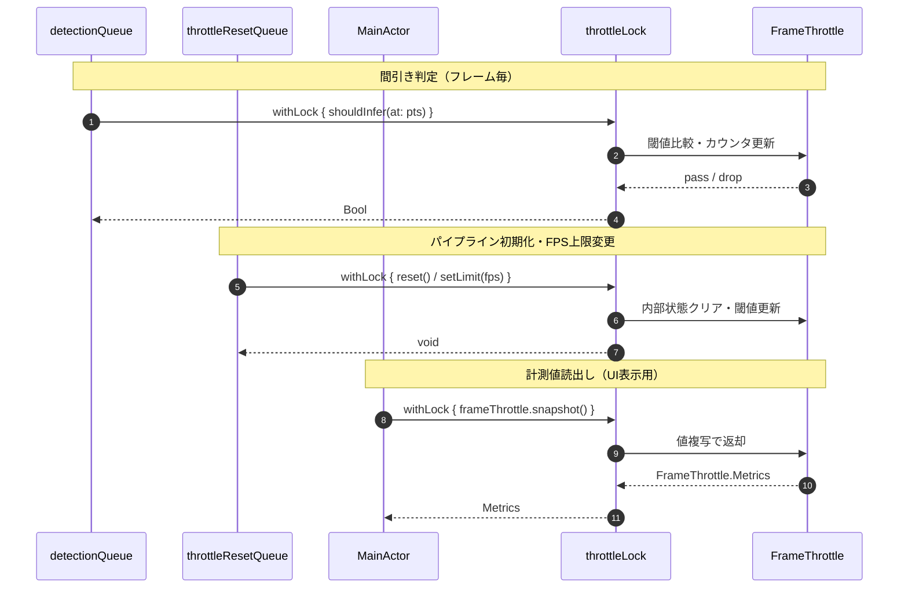

**保護対象**: `FrameThrottle`（値型：`lastInferenceTime`、`inferenceCount`、`cumulativeInferenceTime`、`currentLimitFPS`）
**アクセス経路**: detectionQueue（間引き・記録）／throttleResetQueue（reset・上限適用）／Main（計測読出し）

---

### 2.2 LockedMainHopGate.lock (LockedMainHopGate)

```mermaid
sequenceDiagram
    autonumber
    participant DQ as detectionQueue
    participant TRQ as throttleResetQueue
    participant MAIN as MainActor
    participant HL as hopGate.lock
    participant GATE as MainHopGate (値型)
    participant SLOT as slot (Pending?)

    Note over DQ,SLOT: 検出結果の申請・配送判定
    DQ->>HL: submit(detection, aspectRatio, now)
    HL->>SLOT: slot = Pending(detection, aspectRatio)
    HL->>GATE: gate.submit(kind, gatePhase, aspectRatio, at: now)
    GATE-->>HL: .deliver / .coalesce
    alt deliver
        HL->>SLOT: pending = slot; slot = nil
        HL-->>DQ: Pending?
    else coalesce
        HL-->>DQ: nil
    end

    Note over TRQ,GATE: パイプライン初期化
    TRQ->>HL: reset()
    HL->>GATE: gate.reset()
    HL->>SLOT: slot = nil
    HL-->>TRQ: void

    Note over MAIN,GATE: フェーズ反映・計測読出し
    MAIN->>HL: setGatePhase(phase)
    HL->>GATE: gatePhase = phase
    MAIN->>HL: snapshot()
    HL->>GATE: gate.snapshot()
    GATE-->>HL: MainHopGate.Metrics
    HL-->>MAIN: Metrics
```

**保護対象**: `MainHopGate`（値型）、`gatePhase`（GatePhase）、`slot`（Pending? 単一スロット）
**アクセス経路**: detectionQueue（submit）／throttleResetQueue（reset）／Main（setGatePhase・計測読出し）
**特徴**: 単一スロットに最新のみ保持、待機蓄積を作らない（`pendingCount` は 0/1）

---

### 2.3 SharedState.lock (MotionService)

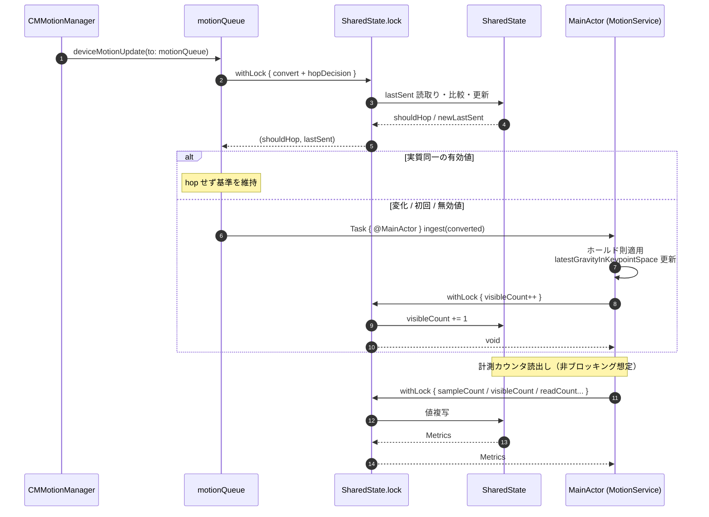

**保護対象**: `lastSent`、`measuring`、`measureFrequency`、`measureStart`、`measureNote`、`sampleCount`、`visibleCount`、`readCount`、`invalidReadCount`
**アクセス経路**: motionQueue（一段目：変換・hop判定）／Main（ingest・計測読出し）

---

### 2.4 metricsLock (PoseDetector)

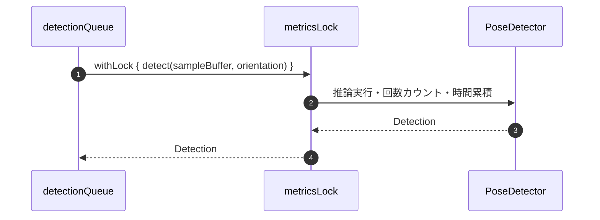

**保護対象**: `inferenceCount`、`cumulativeInferenceTime`（推論メトリクスのみ）
**アクセス経路**: detectionQueue（detect のみ、単一キュー上なので実質排他不要だが明示的保護）

---

### 2.5 ProlongedAbsenceTracker.lock (ProlongedAbsenceTracker)

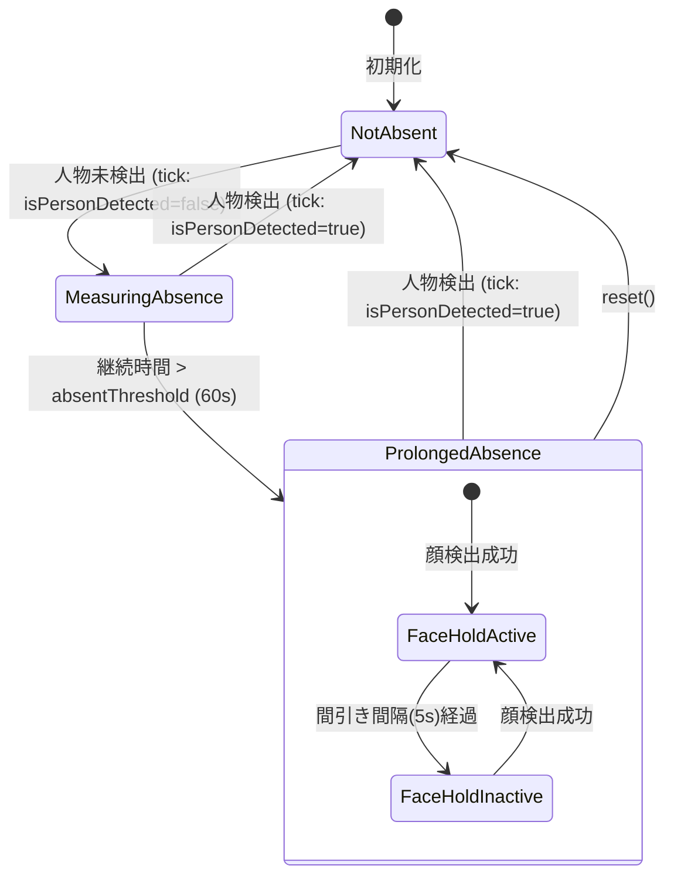

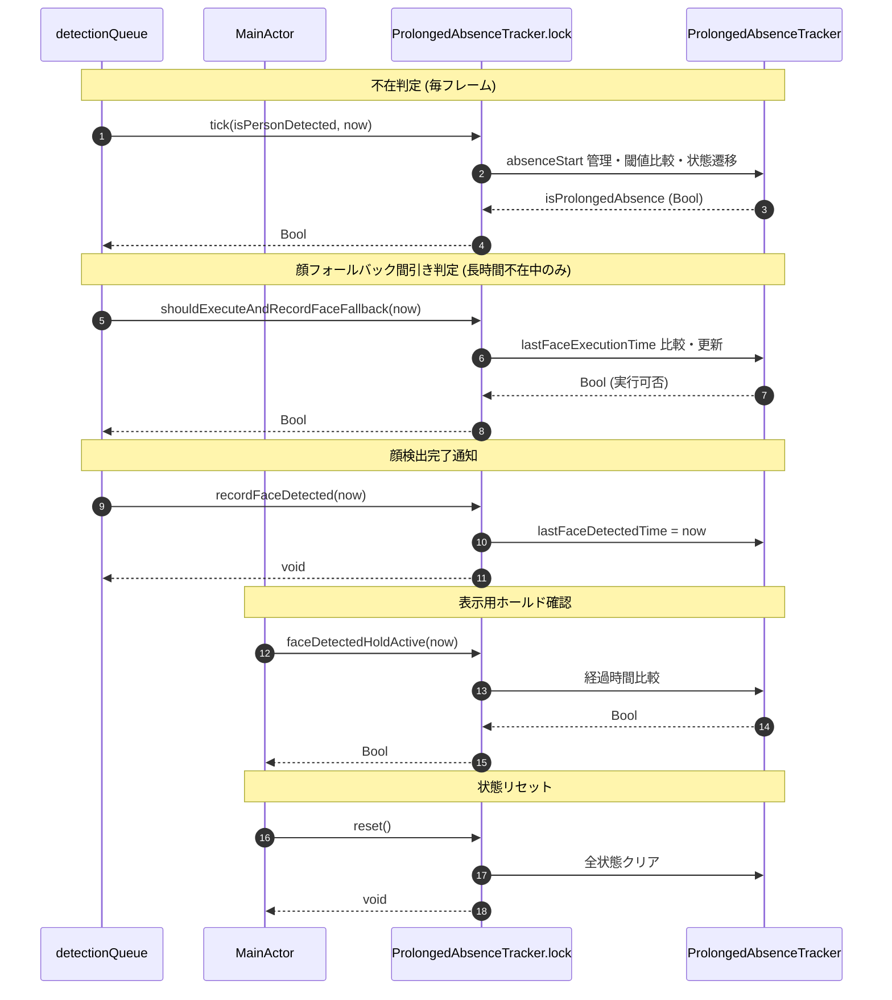

**保護対象**: `_isProlongedAbsence`、`absenceStart`、`lastFaceExecutionTime`、`lastFaceDetectedTime`
**アクセス経路**: detectionQueue（tick・shouldExecuteAndRecordFaceFallback・recordFaceDetected）／Main（isProlongedAbsence・faceDetectedHoldActive・reset・snapshot）

---

## 3. ロック取得順序とデッドロック防止

**このプロジェクトではロック階層を設けない**。各共有状態が単一のロックを独立に保持し、複数ロックを同時に保持するコードパスは存在しない。

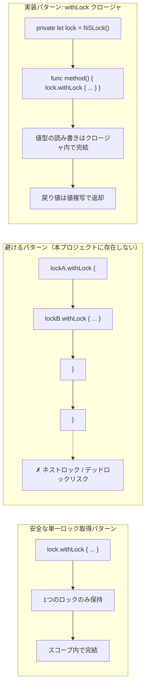

**設計規則**（`tech.md` 準拠）:
- 各共有状態が単一の `NSLock` を所有する
- ロックのネスト・階層化は行わない（新設しない）
- `withLock` クロージャ内で値型の読み書きを完結させる
- 戻り値は値複写（`struct` のコピー）で返し、参照を漏らさない

---

## 4. nonisolated(unsafe) とロックの協調

`PostureSessionManager` では、検出キューから直接参照する値を `nonisolated(unsafe)` で公開し、実態の保全は各ロックに委ねる。

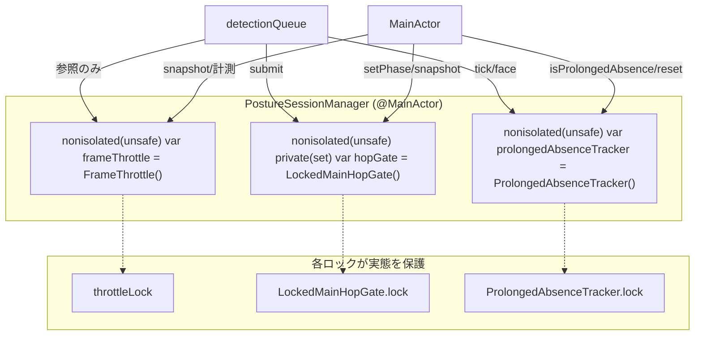

**なぜ安全か**:
- 参照自体は不変（同一インスタンスを指し続ける）
- 可変状態への書き込み・読み出しは必ず対応するロック経由
- 新たなロック階層を増やさず、既存ロックで完結させる

---

## 5. DispatchQueue と NSLock の使い分け指針

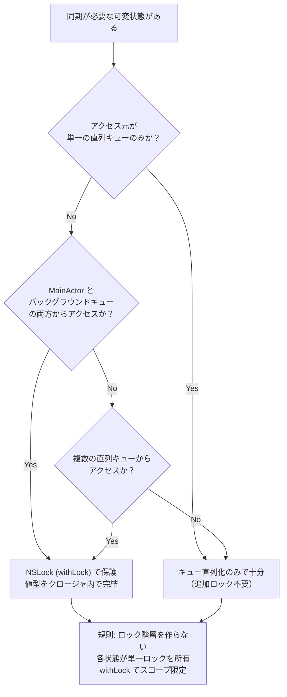

**判断基準**:
| 状況 | 選択 | 例 |
|---|---|---|
| 単一キューのみからアクセス | キュー直列化のみ | `PoseDetector.metricsLock`（実質 detectionQueue のみ） |
| MainActor ↔ バックグラウンドキュー | NSLock | `FrameThrottle`、`LockedMainHopGate`、`SharedState`、`ProlongedAbsenceTracker` |
| 複数の直列キューからアクセス | NSLock | `throttleLock`（detectionQueue + throttleResetQueue + Main） |

---

## 6. 実装テンプレート: NSLock によるスレッドセーフ値型ラッパ

本プロジェクトで採用している標準パターン：

```swift
/// スレッドセーフな値型ホルダの標準実装パターン
final class ThreadSafe<Value>: @unchecked Sendable {
    private let lock = NSLock()
    private var value: Value

    init(_ initial: Value) { self.value = initial }

    /// 変更を伴う操作（書き込み・読み書き）
    func mutate<T>(_ body: (inout Value) throws -> T) rethrows -> T {
        try lock.withLock { try body(&value) }
    }

    /// 読み取り専用操作（値複写で返却）
    func read<T>(_ body: (Value) throws -> T) rethrows -> T {
        try lock.withLock { try body(value) }
    }

    /// 値の完全置換
    var snapshot: Value {
        lock.withLock { value }
    }
}
```

**実際の使用例**（`LockedMainHopGate` 等）:
- `private let lock = NSLock()`
- `private var state: StateType`
- 全メソッドが `lock.withLock { ... }` で実装
- `@unchecked Sendable` 適合でキュー間共有を許可

---

## 7. 時計系の統一とロック内での利用

すべての経過時間判定・ゲート・しきい値比較は **単調時刻系（`CACurrentMediaTime` 系 / `TimeInterval`）** を使用する。

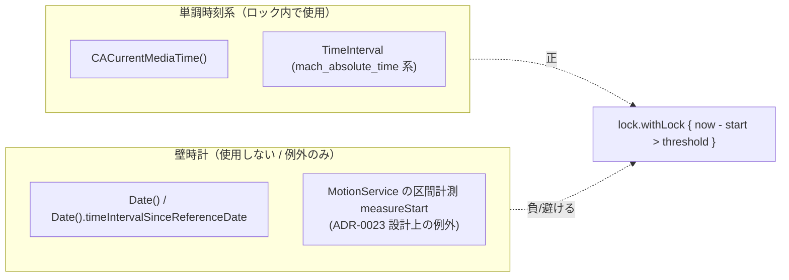

**対象コード**: `FrameThrottle.shouldInfer`、`MainHopGate.submit`、`ProlongedAbsenceTracker.tick`、`MotionService` の二段比較
**例外**: `MotionService.SharedState.measureStart` のみ `Date` を使用（区間計測用、判定ロジックには不使用）

---

## 8. テスト観点でのロック検証

```mermaid
flowchart TB
    subgraph UNIT["単体テスト（値型直接検証）"]
        UT1["FrameThrottle / MainHopGate / ProlongedAbsenceTracker"] --> UT2["構造体メソッドを直接呼び出し"]
        UT2 --> UT3["ロックなしでロジック検証"]
    end

    subgraph INTEGRATION["結合テスト（ロック経由検証）"]
        IT1["PostureSessionManager / MotionService"] --> IT2["@testable import で非公開状態アクセス"]
        IT2 --> IT3["複数キュー並行実行でデータ競合不在を確認"]
        IT3 --> IT4["ThreadSanitizer (TSan) で検証"]
    end

    subgraph STRESS["ストレステスト"]
        ST1["大量フレーム同時投入"] --> ST2["detectionQueue + throttleResetQueue + Main 並行"]
        ST2 --> ST3["deadlock / priority inversion 不在確認"]
    end
```

**検証コマンド**:
```bash
# ThreadSanitizer 付きテスト実行
xcodebuild test -scheme NekozeFix \
  -destination 'platform=iOS Simulator,name=iPhone 17 Pro' \
  -enableThreadSanitizer YES
```

---

## 9. まとめ: 同期機構の設計原則

1. **単一所有**: 各可変状態は単一の `NSLock` が所有する
2. **階層なし**: 複数ロックのネスト・階層化を避ける（デッドロック防止）
3. **スコープ限定**: `withLock` クロージャ内で読み書きを完結
4. **値複写返却**: 参照を漏らさず `struct` コピーで返す
5. **非同期配送**: 状態変更は直列キューへ `async` 配送し、MainActor をブロックしない
6. **単調時刻**: 経過時間判定は `CACurrentMediaTime` 系で統一
7. **テスト可能性**: 値型ロジックはロックなしで単体テスト、結合でロック経由を検証

これらの原則は `tech.md`「Concurrency Model」および各 ADR（0022, 0023, 0024）に基づき、判定の正しさ・省電力・応答性のバランスを保つために厳守する。